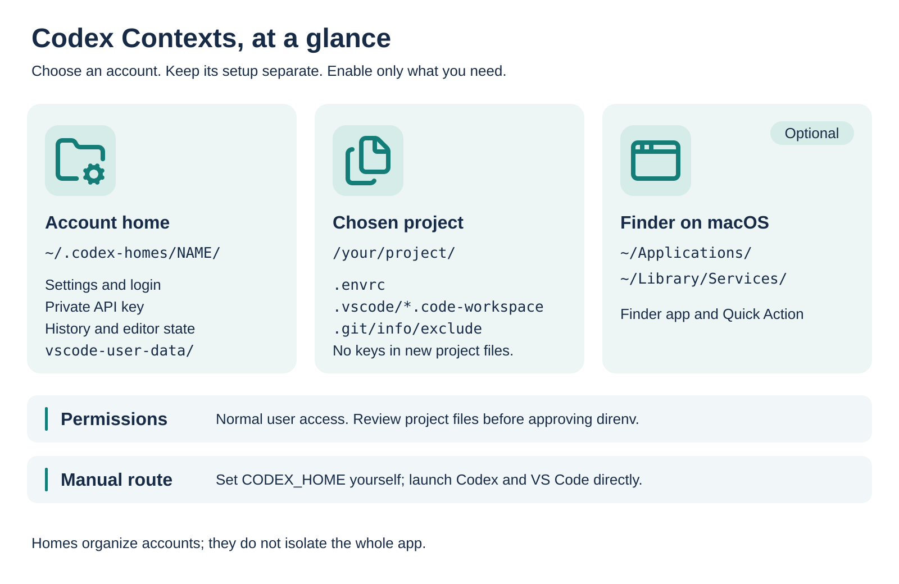

# Installation

Codex Contexts selects separate local account homes and opens projects with
that choice. Use the helpers below, or [set it up manually](#manual-setup).



The helper needs your normal write access to the chosen folders, not `sudo`.
Installing prerequisites may need administrator rights. macOS may ask for
access to protected project folders. Shell-startup changes below are manual.

<details>
<summary>Exactly what gets written</summary>

Default locations; custom roots and Git worktrees can differ.

| Choice | Files or state written |
|---|---|
| Create an identity | `~/.codex-homes/NAME/config.toml`, `.identity-kind`, and small lock/metadata files. New homes are private (`700`); helper-written settings and new key files use `600`. The `default` identity refers to existing `~/.codex`. |
| Sign in / save an API key | Codex writes `auth.json` in that home, or uses the explicitly selected OS keyring. `set-key` writes `api-key.env`. Keep the home outside Git and cloud sync. |
| Assign a project | `PROJECT/.envrc`, `.vscode/<folder>.code-workspace`, and local Git exclusions, usually `.git/info/exclude`. New project files contain paths and labels, not keys. |
| Approve direnv | Its own [approval record](https://direnv.net/man/direnv.1.html#files) under `~/.local/share/direnv/allow` by default. Read `.envrc` before allowing it. |
| Use Codex / VS Code | Codex creates sessions/logs in the selected home; editor state uses its `vscode-user-data/`. Existing shared extensions may be reused. |
| Enable extras | U-M settings/catalogs and shared-skill links live under the homes root. Optional Finder integration writes `~/Applications/Codex Project.app` and `~/Library/Services/Open in Codex Project.workflow`; named editor copies live inside the identity home. |

First project setup refuses existing or tracked destinations. Change/reset
manage recognized generated files; reset keeps accounts and credentials.
Finder uninstall moves owned integration bundles to Trash; cleanup `--apply`
permanently deletes recognized generated copies/backups. See
[removal](docs/remove-folder-context.md) and [macOS cleanup](docs/macos-open-with.md).

</details>

## Manual setup

Use the official Codex CLI and create the files yourself. The walkthrough covers
account sign-in, folder selection with direnv, and VS Code.
[Manual setup guide](docs/manual-setup.md)

**Scope and limits:** the launcher chooses a local account home and starts
Codex or VS Code. The helper, `.envrc`, and editor run with your user
permissions. The optional Codex command sandbox applies to agent commands.
[Permission boundaries](docs/security.md#what-an-approval-allows)

## 1. Install prerequisites

Use macOS or Linux with Bash 3.2+, Python 3.11+, and the
[Codex CLI](https://learn.chatgpt.com/docs/codex/cli).

| System | Install the supporting tools |
|---|---|
| macOS, with [Homebrew](https://brew.sh/) | `brew install git direnv jq python` |
| Debian / Ubuntu | `sudo apt install bash bubblewrap curl direnv git jq python3` |

After installing, check the versions in the same terminal.

```bash
python3 --version
direnv version
```

Use Python 3.11+ and direnv 2.32.2+ for the folder workflow. Debian 12 and Ubuntu
24.04 package direnv 2.32.1. If `direnv version` reports an older release, install
a supported release for your architecture, put it earlier on `PATH`, then check
`command -v direnv` and `direnv version` again.
[direnv installation](https://direnv.net/docs/installation.html) | [Debian package](https://packages.debian.org/bookworm/direnv) | [Ubuntu package](https://packages.ubuntu.com/en/noble/direnv)

Terminal commands need a `codex` executable on `PATH`. The VS Code extension's
bundled copy may be available only inside the editor. On macOS with Homebrew,
install the CLI separately:

```bash
brew install --cask codex
```

For Linux or other installation methods, follow the
[Codex CLI installation guide](https://learn.chatgpt.com/docs/codex/cli).
Verify from the same terminal where you will run `codex-home`:

```bash
command -v codex
codex --version
```

Expect an executable path and a `codex-cli` version. If either check fails,
finish CLI installation or add its executable directory to `PATH` before
running `codex-home login`, `run`, or `doctor`.

Model discovery needs curl 7.76+. The helper uses Python's standard library.

For VS Code, install the Codex extension. Check your API provider with a
tool-call test before using project data.
[Codex extension](https://learn.chatgpt.com/docs/codex/ide) | [API compatibility check](docs/api-providers.md#validate-compatibility)

## 2. Enable direnv in your shell

The optional hook loads the approved context when you enter a project. You can
also use `direnv exec . codex-home run` from the project, use an explicit
`codex-home run NAME`, or launch through VS Code or Finder.

| Your shell | Add to its startup file |
|---|---|
| zsh: `~/.zshrc` | `eval "$(direnv hook zsh)"` |
| Bash, non-login: `~/.bashrc` | `eval "$(direnv hook bash)"` |
| Bash, login: `~/.bash_profile` or your active login startup file | Source `~/.bashrc` from that file, or add the hook there once. |

Open a new terminal after editing the file. For the current shell, run the matching
`eval` line directly.

## 3. Clone and validate

```bash
mkdir -p "$HOME/Developer"
cd "$HOME/Developer"
git clone https://github.com/FritscheLab/codex-contexts.git
cd codex-contexts
```

### Review the checkout before running it

Check that `origin` is the repository you intended, note the commit you are
reviewing, and account for local changes.

```bash
git remote get-url origin
git rev-parse HEAD
git status --short
```

Open `bin/codex-home` and the shell and Python files it uses in `libexec/` as
text. For Finder setup, review the installer in `bin/` and the sources in
`macos/` too. Even `codex-home help` loads the shell libraries in this checkout.
The tests also execute repository code. Review the scripts first, run them as
your own user, and try the workflow on a disposable folder with sample files.
If you prefer to configure the underlying tools yourself, use the manual steps.
[Source map and test coverage](CONTRIBUTING.md#development-setup) | [Manual setup](docs/manual-setup.md)

When you are ready to run this checkout, add its `bin/` to your current shell.

```bash
export PATH="$PWD/bin:$PATH"
codex-home help
```

Expect `Usage: codex-home COMMAND [ARGS...]`. The export applies to the current
shell. To use the helper in new terminals, add this line to the startup file for
your shell, using the actual clone path.

```bash
export PATH="$HOME/Developer/codex-contexts/bin:$PATH"
```

Keep the clone in a stable location because generated project files point to it.
For an optional offline check, run `./tests/test.sh` from the clone. It uses
temporary identities and mock programs and requires `expect` (`sudo apt install
expect` on Debian/Ubuntu, or `brew install expect` if it is missing on macOS).
[Development checks](CONTRIBUTING.md#development-setup)

## 4. Configure an identity

| Your sign-in | Follow |
|---|---|
| ChatGPT account | [ChatGPT setup](docs/subscriptions.md) |
| U-M Toolkit API key | [U-M GPT setup](docs/umgpt.md) |
| Another API key or Azure endpoint | [API setup](docs/api-providers.md) |

## 5. Configure a project

Return to [Start here](README.md#start-here) for the short workflow.
[Project setup](docs/projects-vscode.md) covers existing `.envrc` files,
switching identities, and VS Code. On macOS,
[Finder integration](docs/macos-open-with.md#install-the-finder-integration)
is optional.

## Updating this repository

From the clone, save local edits and check that `origin` still points to the
expected repository. Fetch and inspect the changes before running the updated
code.

```bash
git status --short
git fetch origin
review_commit="$(git rev-parse origin/main)"
git diff --no-ext-diff --no-textconv HEAD "$review_commit"
```

Once you have reviewed that commit, update to it in the same terminal.

```bash
git merge --ff-only "$review_commit"
```

Approved project files point to the helper path. They can pick up new code at
that path without a new direnv prompt. Reinstall the Finder integration if you
use it. [Finder installer](docs/macos-open-with.md#install-the-finder-integration) | [Migrate older credential settings](docs/security.md#secret-exposure-boundaries)

## Machine-local setup

Repeat account sign-in and project setup on each computer. Keep credentials
and identity homes outside Git, cloud-sync folders, and shared drives.
[Removal instructions](docs/remove-folder-context.md) cover removing a folder's context.
