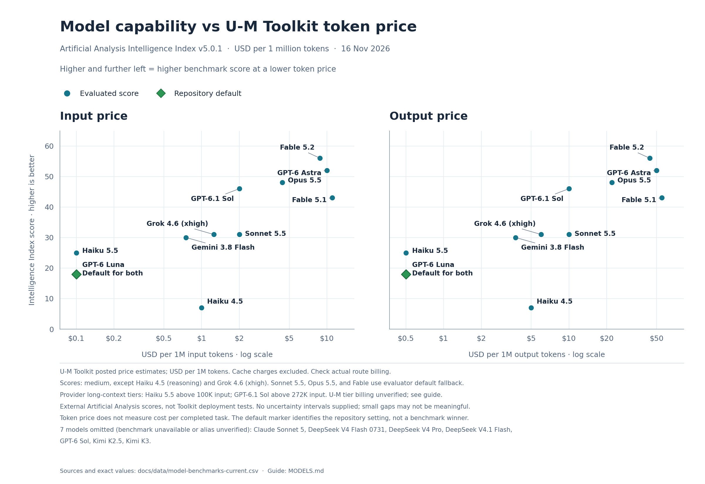

# Model settings and comparison

[Change defaults and order](#change-defaults-and-order) · [Compare models](#compare-models) · [All models and source details](docs/model-reference.md)

Compare models below before [setting up U-M GPT](docs/umgpt.md). Once your
`umgpt` or `umgpt-low` identity exists, use the steps here to change its saved
default and picker order.

## Change defaults and order

Run these commands from the repository directory, after creating the identity
you want to update. The helper skips either standard identity that does not exist.

**1. Find your settings file.**

```bash
./bin/codex-home model-settings
```

Open the path printed after **Edit your settings:**, normally
`~/.codex-homes/umgpt-models.toml`. Your choices survive repository updates.

**2. Choose your defaults and favorites.**

```toml
umgpt = "gpt-6-luna"
umgpt_low = "gpt-6-luna"

umgpt_order = ["gpt-6.1-sol", "gpt-6-sol", "gpt-6-astra"]
umgpt_low_order = ["claude-sonnet-5", "gemini-3.8-flash", "claude-haiku-4-5"]
```

The first two lines select defaults; the arrays put your other favorites in
order. Keep each array on one line. Use `[]` for automatic ordering.
Find exact IDs in the [available model list](docs/model-reference.md#available-models).

The picker shows **your default → your favorites → remaining models by family,
newer versions first**. Sorting never changes your default. The example above
starts the low picker with Luna → Sonnet → Gemini → Haiku.

**3. Apply, reload, and check.**

```bash
./bin/codex-home apply-model-settings
```

Restart the CLI, or run **Developer: Reload Window** in VS Code and start a
**new Codex chat**. Check your choices in the model picker. Run
`model-settings` again to compare saved and active defaults.

[Changes not showing?](docs/model-reference.md#refresh-and-recovery) · [Reset or use a model for one session](docs/model-reference.md#other-model-settings)

## Compare models

**16 November 2026 · USD per million tokens.** Prices are
[U-M Toolkit standard estimates](https://its.umich.edu/computing/ai/pricing).
Scores use Artificial Analysis **Intelligence Index v5.0.1**; higher is better.
[Price conditions, evaluator settings, and sources](docs/model-reference.md#prices-and-limits).

This shortlist covers 18 currently advertised text models. Eleven have a
verified score for the displayed effort; missing scores remain blank rather
than borrowing a result from another index version or model revision.

| Model | Evaluated effort | Index | U-M input | U-M output | Tokens/s¹ |
|---|---|---:|---:|---:|---:|
| [GPT-6 Luna](https://artificialanalysis.ai/models/creators/openai) | Medium | 18 | $0.10 | $0.50 | 95 |
| [GPT-6 Sol](https://artificialanalysis.ai/models/creators/openai) | Medium | — | $2.00 | $10.00 | — |
| [GPT-6 Astra](https://artificialanalysis.ai/models/creators/openai) | Medium | 52 | $10.00 | $50.00 | 44 |
| [GPT-6.1 Sol](https://artificialanalysis.ai/models/creators/openai) | Medium | 46 | $2.00 | $10.00 | 52 |
| [Claude Haiku 4.5](https://artificialanalysis.ai/models/creators/anthropic) | Reasoning | 7 | $1.00 | $5.00 | 116 |
| [Claude Haiku 5.5](https://artificialanalysis.ai/models/creators/anthropic) | Medium | 25 | $0.10 | $0.50 | 221 |
| [Claude Sonnet 5](https://artificialanalysis.ai/models/creators/anthropic) | Medium | — | $2.20 | $11.00 | 102 |
| [Claude Sonnet 5.5](https://artificialanalysis.ai/models/creators/anthropic) | Medium† | 31 | $2.00 | $10.00 | 128 |
| [Claude Opus 5.5](https://artificialanalysis.ai/models/creators/anthropic) | Medium† | 48 | $4.40 | $22.00 | 107 |
| [Claude Fable 5.1](https://artificialanalysis.ai/models/creators/anthropic) | Medium† | 43 | $11.00 | $55.00 | 87 |
| [Claude Fable 5.2](https://artificialanalysis.ai/models/creators/anthropic) | Medium† | 56 | $8.80 | $44.00 | 104 |
| [Gemini 3.8 Flash](https://artificialanalysis.ai/models/creators/google) | Medium | 30 | $0.75 | $3.75 | 118 |
| [Grok 4.6](https://artificialanalysis.ai/models/grok-4-6) | Xhigh | 31 | $1.25 | $6.00 | 71 |
| [DeepSeek V4 Flash 0731](https://artificialanalysis.ai/models/deepseek-v4-flash) | Max | — | $0.19 | $0.51 | 141 |
| [DeepSeek V4.1 Flash](https://artificialanalysis.ai/models/deepseek-v4-1-flash) | Revision unverified | — | $0.30 | $1.20 | — |
| [DeepSeek V4 Pro](https://artificialanalysis.ai/models/deepseek-v4-pro) | Revision unverified | — | $1.74 | $3.48 | — |
| [Kimi K3](https://artificialanalysis.ai/models/kimi-k3) | Max | — | $3.00 | $15.00 | 48 |
| [Kimi K2.5](https://artificialanalysis.ai/models/kimi-k2-5) | Reasoning | — | $0.60 | $3.00 | 43 |

† Evaluator's default fallback configuration. ¹ External end-to-end output
speed, including time to first token; not measured through U-M. “—” means no
verified comparable value. Efforts differ where shown; these are not settings
the helper applies. [Detailed qualifications](docs/model-reference.md#benchmark-notes).

Rates depend on context/cache and can change. Haiku 5.5's provider has a
higher-price tier above 100K input tokens; GPT-6.1 Sol's provider has a tier
above 272K. [Provider conditions versus U-M estimates](docs/model-reference.md#context-and-cache-conditions).
Token prices do not determine cost per completed task.

Luna remains the repository default for both identities. Compare models on
your own tasks and verify the selected route before use; a listed ID and an
external benchmark do not establish Codex tool-call compatibility.



Higher and further left indicates a higher benchmark score at a lower token
price. No uncertainty intervals are supplied; small score gaps may not be
meaningful. [Full-size chart](docs/images/model-cost-performance-umgpt.png) ·
[Editable SVG](docs/images/model-cost-performance-umgpt.svg) ·
[Current data and sources (CSV)](docs/data/model-benchmarks-current.csv)

The [September 2026 comparison](docs/model-comparison-2026-09-24.md), its
provider prices, and v4.3.2 scores are archived separately. The two index
versions are not directly comparable.

[Back to README](README.md) · [U-M GPT setup](docs/umgpt.md)
