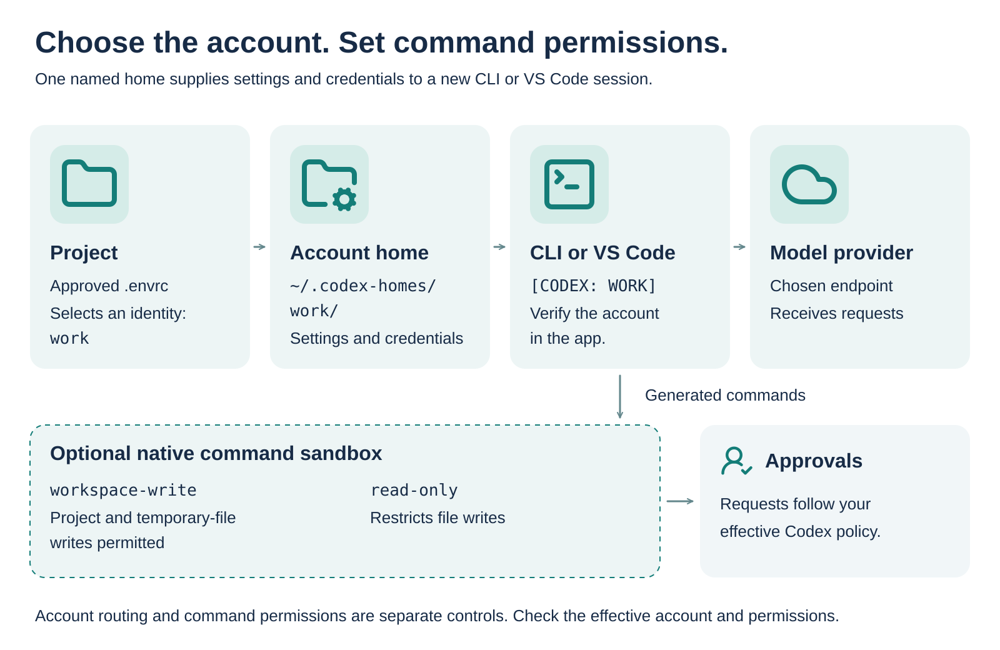

# Codex Contexts

Use different Codex accounts for different projects. Each account has its own
login, settings, and history; terminal and VS Code labels show your choice.

## Start here

**Choose an account → Assign a folder → Launch.**

First, [see what it writes, permissions, and manual alternatives](INSTALLATION.md),
then install the prerequisites and clone this repo.
Then choose how you sign in:

| You have… | Create your identity | Guide |
|---|---|---|
| A ChatGPT account | `codex-home create-subscription work`, then `codex-home login work` | [ChatGPT](docs/subscriptions.md) |
| A U-M Toolkit key | `codex-home create-umgpt`, then `codex-home set-key umgpt` | [U-M GPT](docs/umgpt.md) |
| Another API key | `codex-home create-api NAME URL MODEL KEY_ENV`, then `codex-home set-key NAME` | [API setup](docs/api-providers.md) |

Check the intended account and workspace in the browser during sign-in.

Assign that identity to a project. Replace `work` and the path with yours:

```bash
codex-home project work "/path/to/project"
```

Read the generated `.envrc`, then approve it and enter the project:

```bash
direnv allow "/path/to/project"
cd "/path/to/project"
```

Choose where to work:

| Where? | Launch |
|---|---|
| Terminal | `codex-home run work` |
| VS Code | `codex-home vscode work "/path/to/project"` |
| Finder on macOS | [Install the optional right-click action](docs/macos-open-with.md#install-the-finder-integration) |

Ordinary **Open With → VS Code** bypasses this selection and may use `~/.codex`.

## Account choice and command permissions



Want Codex to edit inside a command sandbox?

```bash
codex-home set-sandbox work workspace-write
```

Use `read-only` for review. These are configurable defaults, not isolation of
the whole app. [Choose permissions and understand the boundary](docs/security.md#optional-native-sandbox).

<details>
<summary>Reference and troubleshooting</summary>

- [All commands](docs/commands.md) · [Fix a problem](docs/troubleshooting.md)
- [Project setup and switching](docs/projects-vscode.md) · [Remove a project context](docs/remove-folder-context.md)
- [Model settings and comparisons](MODELS.md) · [Share skills](docs/skills.md)
- [Security and credentials](docs/security.md) · [Two-page cheatsheet](docs/codex-contexts-cheatsheet.pdf)
- [Contribute](CONTRIBUTING.md) · [Report a vulnerability](SECURITY.md)

</details>

Developed at the [Fritsche Lab](https://fritschelab.org/), University of Michigan.
Inspired by Ryan Welch's labeled `direnv` setup. [MIT License](LICENSE).
