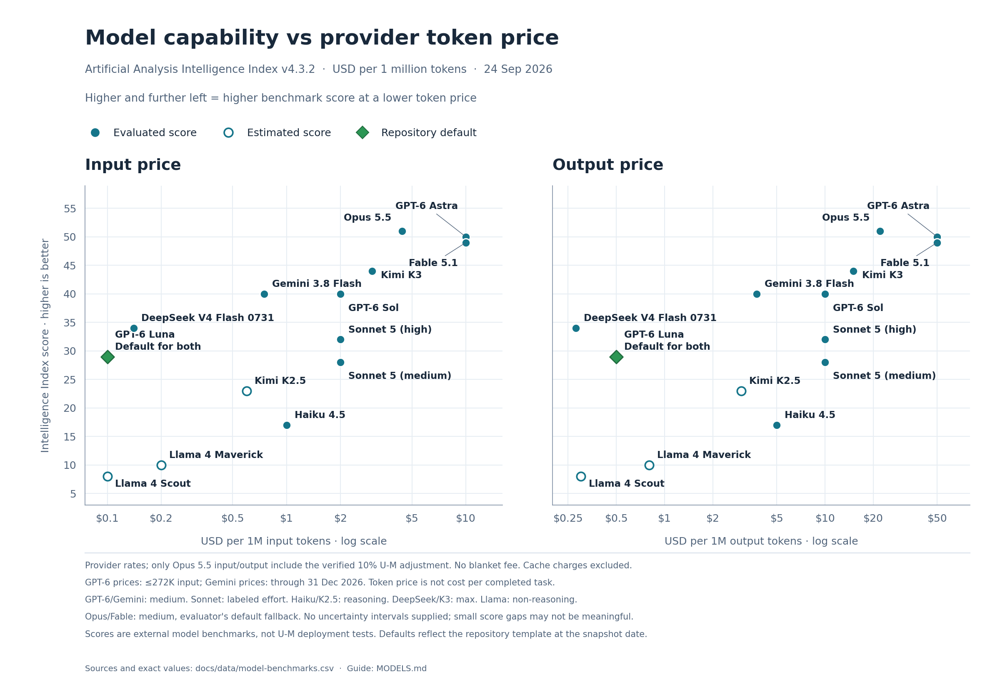

# Model comparison archive: 24 September 2026

This preserves the September comparison, including its provider-price basis,
Intelligence Index v4.3.2 scores, and qualifications as recorded at that time.
Prices, availability, scores, and linked live pages may have changed. Use
[the current comparison](../MODELS.md#compare-models) for the latest checked
Toolkit prices and index version. Do not compare scores across index versions.

## Comparison

**24 September 2026 · USD per million tokens.** Scores use Artificial Analysis
**Intelligence Index v4.3.2**; higher is better. Prices use provider rates,
with only Opus 5.5's verified 10% U-M adjustment. [Sources and pricing conditions](#prices-and-limits).

This is a dated reference. Check the linked provider prices before spending,
and run `codex-home models NAME` for the models currently available to your identity.

| Model | Index | Input | Output | Context¹ | Tokens/s² |
|---|---:|---:|---:|---:|---:|
| [GPT-6 Luna](https://artificialanalysis.ai/models/gpt-6-luna-medium) | 29 | $0.10 | $0.50 | 1.05M | 142.8 |
| [GPT-6 Sol](https://artificialanalysis.ai/models/gpt-6-sol-medium) | 40 | $2.00 | $10.00 | 1.05M | 114.3 |
| [GPT-6 Astra](https://artificialanalysis.ai/models/gpt-6-astra-medium) | 50 | $10.00 | $50.00 | 1.05M | 45.3 |
| [Claude Haiku 4.5](https://artificialanalysis.ai/models/claude-4-5-haiku-reasoning) | 17 | $1.00 | $5.00 | 200K | 96.1 |
| [Claude Sonnet 5](https://artificialanalysis.ai/models/claude-sonnet-5-medium) | 28 | $2.00 | $10.00 | 1M | 67.1 |
| [Claude Opus 5.5](https://artificialanalysis.ai/models/claude-opus-5-5-medium) | 51 | $4.40 | $22.00 | 1M | 77.9 |
| [Claude Fable 5.1](https://artificialanalysis.ai/models/claude-fable-5-1-medium/) | 49 | $10.00 | $50.00 | 1M | 54.1 |
| [Gemini 3.8 Flash](https://artificialanalysis.ai/models/gemini-3-8-flash-medium) | 40 | $0.75 | $3.75 | 1M input | — |
| [DeepSeek V4 Flash 0731](https://artificialanalysis.ai/models/deepseek-v4-flash) | 34 | $0.14 | $0.28 | 1M | 221.1 |
| [Kimi K3](https://artificialanalysis.ai/models/kimi-k3) | 44 | $3.00 | $15.00 | 1M | 35.3 |
| [Kimi K2.5](https://artificialanalysis.ai/models/kimi-k2-5) | 23* | $0.60 | $3.00 | 256K | — |
| [Llama 4 Maverick](https://artificialanalysis.ai/models/llama-4-maverick) | 10* | $0.20 | $0.80 | 1M | 114.9 |
| [Llama 4 Scout](https://artificialanalysis.ai/models/llama-4-scout/) | 8* | $0.10 | $0.30 | 328K | 100.1 |

\* Estimated by the evaluator; independent evaluation on this index is pending.
¹ Rounded provider limits, not verified U-M limits. ² Output speed after the
initial wait, not measured through U-M. “—” means not reported.
[Test settings, cached-input prices, exact limits, and qualifications](#prices-and-limits).

In this shortlist, Sonnet 5 at medium effort is the closest Claude option to
Luna on this index. Haiku is the cheaper Claude alternative. Luna is the
repository default for both identities.



Higher and further left means a higher score at a lower token price; token
price does not measure cost per completed task. The chart also shows Sonnet
at high effort (index 32; 65.4 tokens/s). Small score gaps may not be meaningful.

[Full-size chart](images/model-cost-performance-direct.png) · [SVG](images/model-cost-performance-direct.svg) · [Data and sources (CSV)](data/model-benchmarks.csv)

## Prices and limits

Checked **2026-09-24**. The [comparison table](#comparison) contains
input/output prices, context sizes, and performance. The additional values and
primary sources below complete that table. All prices are USD per million tokens.

| Model | Cached input | Maximum output | Price source | Limit source |
|---|---:|---:|---|---|
| GPT-6 Luna | $0.01 | 128,000 | [OpenAI](https://developers.openai.com/api/docs/pricing) | [Model](https://developers.openai.com/api/docs/models/gpt-6-luna) |
| GPT-6 Sol | $0.20 | 128,000 | [OpenAI](https://developers.openai.com/api/docs/pricing) | [Model](https://developers.openai.com/api/docs/models/gpt-6-sol) |
| GPT-6 Astra | $1.00 | 128,000 | [OpenAI](https://developers.openai.com/api/docs/pricing) | [Model](https://developers.openai.com/api/docs/models/gpt-6-astra) |
| Claude Haiku 4.5 | $0.10 | 64K | [Anthropic](https://platform.claude.com/docs/en/about-claude/pricing) | [Models](https://platform.claude.com/docs/en/models/overview) |
| Claude Sonnet 5 | $0.20 | 128K | [Anthropic](https://platform.claude.com/docs/en/about-claude/pricing) | [Models](https://platform.claude.com/docs/en/models/overview) |
| Claude Opus 5.5 | $0.20 base | 128K | [Anthropic](https://platform.claude.com/docs/en/about-claude/pricing) | [Models](https://platform.claude.com/docs/en/models/overview) |
| Claude Fable 5.1 | $0.25 | 128K | [Anthropic](https://platform.claude.com/docs/en/about-claude/pricing) | [Models](https://platform.claude.com/docs/en/models/overview) |
| Gemini 3.8 Flash | $0.075 | 65,536 | [Google](https://ai.google.dev/gemini-api/docs/pricing) | [Model](https://ai.google.dev/gemini-api/docs/models/gemini-3.8-flash) |
| DeepSeek V4 Flash 0731 | $0.03 | Not verified | [Together AI](https://www.together.ai/pricing) | [Model](https://www.together.ai/models/deepseek-v4-flash-0731) |
| Kimi K3 | $0.30 | Not verified | [Together AI](https://www.together.ai/pricing) | [Kimi guide](https://platform.kimi.ai/docs/guide/kimi-k3-quickstart) |
| Kimi K2.5 | $0.10 | Not verified | [Novita](https://novita.ai/console/pricing-console) | [Moonshot](https://huggingface.co/moonshotai/Kimi-K2.5) |
| Llama 4 Maverick FP8 | Not verified | Not verified | [DeepInfra](https://deepinfra.com/meta-llama/Llama-4-Maverick-17B-128E-Instruct-FP8) | Same endpoint |
| Llama 4 Scout | Not verified | Not verified | [DeepInfra](https://deepinfra.com/meta-llama/Llama-4-Scout-17B-16E-Instruct) | Same endpoint |

### Pricing basis

Use standard, global provider prices where available. For open models, use
the named host's published rate. This does not identify U-M's deployment or
guarantee its bill. The comparison applies only the observed **Opus 5.5
input/output adjustment of 10%**. U-M does not publish cache prices; no cache
surcharge or blanket family fee is inferred.

<details>
<summary>Evidence: provider prices versus posted U-M prices</summary>

This compares base provider prices with U-M's published input/output prices;
a difference does not establish its cause. Source rates: [U-M](https://its.umich.edu/computing/ai/pricing),
[Anthropic](https://platform.claude.com/docs/en/about-claude/pricing), and the
named hosting sources in the table above.

| Model | Provider input / output | U-M input / output | Observed difference |
|---|---:|---:|---|
| Haiku 4.5 | $1 / $5 | $1 / $5 | None |
| Sonnet 5 | $2 / $10 | $2 / $10 | None |
| Opus 5.5 | $4 / $20 | $4.40 / $22 | +10% on both |
| Fable 5.1 | $10 / $50 | $10 / $50 | None |
| Kimi K2.5 (Novita) | $0.60 / $3 | $0.60 / $3 | None |
| Llama 4 Maverick (DeepInfra) | $0.20 / $0.80 | $0.35 / $1.41 | +75% / +76.25%; different hosting rates |
| Llama 4 Scout (DeepInfra) | $0.10 / $0.30 | $0.20 / $0.78 | +100% / +160%; different hosting rates |
| DeepSeek V4 Flash 0731, Kimi K3 | See comparison table | Not listed | Cannot infer an adjustment |

Use the [Toolkit portal](https://toolkit.umgpt.umich.edu/) for actual charges.

</details>

### Special rates and context limits

- **GPT-6:** the displayed prices apply through 272K input tokens. Above that,
  input/cache prices double and output prices rise 50% for the full request.
  Short-context cache writes cost $0.125 / $2.50 / $12.50 for Luna / Sol / Astra.
  All three have 1,050,000 context, capped at 922,000 input and 128,000 output.
  See the OpenAI sources above.
- **Claude:** five-minute cache writes cost $1.25 / $2.50 / $5 / $12.50 for
  Haiku / Sonnet / Opus / Fable; one-hour writes cost $2 / $4 / $8 / $20.
  These are unadjusted Anthropic base prices. See the Anthropic sources above.
- **Gemini 3.8 Flash:** displayed rates apply through 2026-12-31 and double on
  2027-01-01 in Google's schedule; this does not establish future U-M rates.
  Cache storage is extra. The input limit is 1,048,576 tokens, separately from
  maximum output. See the Google sources above.
- **DeepSeek:** Together lists the exact `0731` model. DeepSeek's own Flash
  alias now routes to V4.1, so its current price is not substituted for 0731.
  [Alias changes](https://api-docs.deepseek.com/updates/).
- **Llama:** the selected DeepInfra endpoints provide 1,048,576 context for
  Maverick FP8 and 327,680 for Scout. Scout's native 10M model context is not
  that host's serving limit. See the endpoint sources above.

Published limits can differ from U-M's route. Instructions, tools, and history
also consume context in Codex. These reference values do not change the
helper's conservative runtime metadata; see [catalog behavior](model-reference.md#how-picker-catalogs-work).

<details>
<summary>Azure OpenAI deployment-specific pricing</summary>

The [Azure pricing page](https://azure.microsoft.com/en-us/pricing/details/azure-openai/)
directs readers to Microsoft's GPT-6 announcement while Sol and Luna prices
are being added to its main table. Its **Global Standard, short-context** rates
match OpenAI, checked 2026-09-24.

US Data Zone Standard rates are 10% higher and EU Data Zone Standard rates
20% higher for these GPT-6 models. The source also lists cache-write and
long-context rates. These list prices do not establish the deployment type or
rate billed by U-M. [Microsoft's deployment-specific price table](https://azure.microsoft.com/en-us/blog/gpt-6-astra-sol-and-luna-for-production-agents-in-microsoft-foundry/).

</details>

## Benchmark notes

All capability scores use **Artificial Analysis Intelligence Index v4.3.2**,
a composite of 10 evaluations. It is not a percentage accuracy. See the
[evaluator's methodology](https://artificialanalysis.ai/methodology/intelligence-benchmarking)
and the model-specific links in the [comparison table](#comparison).

| Models | Evaluator setting |
|---|---|
| GPT-6 Luna, Sol, Astra; Gemini 3.8 Flash | Medium |
| Sonnet 5 | Adaptive, medium in the table; high also shown in the plot |
| Opus 5.5; Fable 5.1 | Adaptive, medium, evaluator's default fallback |
| Haiku 4.5; Kimi K2.5 | Reasoning enabled |
| DeepSeek V4 Flash 0731; Kimi K3 | Max |
| Llama 4 Maverick; Llama 4 Scout | Non-reasoning |

These are evaluation settings, not settings the helper applies. Kimi K2.5 and
both Llama index scores are **estimates pending independent evaluation** on
this index. The evaluator marks DeepSeek 0731 and Kimi K2.5 deprecated, limiting
ongoing performance updates; U-M still lists those IDs. Llama's score describes
the model, not U-M's particular quantized deployment.

Output speed measures delivery after generation starts, excluding the initial
wait. Artificial Analysis uses first-party APIs where available and otherwise
provider medians. These are not U-M measurements and need not describe the
host used for pricing. [Speed methodology](https://artificialanalysis.ai/methodology).

### Update the comparison

[Source data](data/model-benchmarks.csv) records exact IDs, evaluation settings,
status, base prices, verification dates, and source links. Adjustments are
separate fields: `price_adjustment_percent` and `adjustment_source`. The
[plot script](build-model-benchmarks.py) multiplies base input/output prices by
`1 + adjustment / 100`; it never fetches or imputes missing data.

Update the dated CSV and corresponding comparison values, then regenerate the
PNG and editable SVG from the repository root with Matplotlib installed:

```bash
python3 docs/build-model-benchmarks.py --data docs/data/model-benchmarks.csv
```

